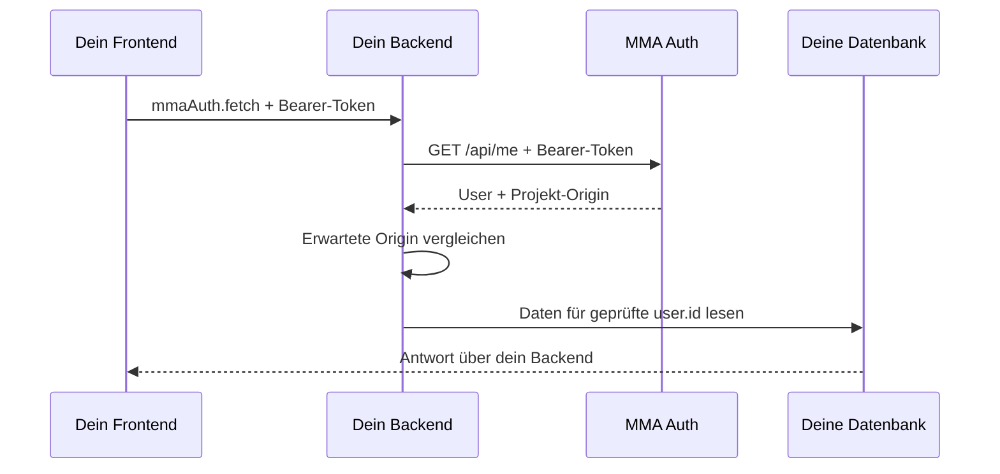

# MMA Auth Starter

**Dein Webprojekt mit MMA-Login – ohne eigene Passwörter, Mailserver oder Registrierung.**

Diese öffentliche Vorlage nutzt den zentralen Dienst [auth.mmacodeclub.ch](https://auth.mmacodeclub.ch). Studierende melden sich mit ihrem MMA-Konto an und erlauben ihrem Projekt den Zugriff auf Name, E-Mail-Adresse und Klasse. Du entwickelst die Funktionen deines Projekts.

**[Eigenes Repository aus dieser Vorlage erstellen →](https://github.com/MMACodeClub/mma-auth-starter/generate)**

## Welcher Einstieg passt zu dir?

| Variante | Dateien | Speicherung | Geeignet für |
| --- | --- | --- | --- |
| HTML, CSS, JavaScript | Hauptordner | Nur im Browser | Den Login kennenlernen, eigenes Frontend starten |
| [PHP + MySQL](examples/php-mysql/README.md) | `examples/php-mysql/` | Eigene MySQL-/MariaDB-Datenbank | Projekte mit PHP und dauerhaften Daten |
| [Node + Express](examples/node-express/README.md) | `examples/node-express/` | Arbeitsspeicher, beim Neustart gelöscht | Tokenprüfung und eigene Node-API verstehen |

Alle Varianten verwenden denselben Login-Dienst. Du brauchst **keinen API-Key und keinen Zugriff auf dessen Datenbank, Admin-Bereich oder SMTP-Konfiguration**. Für das PHP-Beispiel brauchst du eine eigene Projektdatenbank.

## In fünf Minuten starten

### 1. Eigenes Repository anlegen

Klicke oben auf **Use this template → Create a new repository** und wähle einen Namen für dein Projekt. Klone danach **dein neues Repository**, zum Beispiel:

```sh
git clone https://github.com/DEIN-ACCOUNT/DEIN-PROJEKT.git
cd DEIN-PROJEKT
```

Ersetze die Platzhalter durch deinen GitHub-Namen und deinen Projektnamen. Ein Fork ist ebenfalls möglich; für ein unabhängiges Semesterprojekt ist die Template-Funktion der direkte Einstieg.

### 2. Lokalen Webserver starten

Öffne `index.html` mit **Live Server** in VS Code. Alternativ, falls Python 3 installiert ist:

```sh
python3 -m http.server 5500 --bind 127.0.0.1
```

Öffne anschliessend **http://localhost:5500**. Auf Windows heisst der Python-Befehl je nach Installation `py -3` statt `python3`.

Du musst nichts mit npm installieren. Öffne die HTML-Datei nicht per Doppelklick (`file://`): Der Login benötigt einen Webserver. Verwende lokal `localhost` oder `127.0.0.1` statt der LAN-IP deines Computers.

### 3. Anmelden oder registrieren

1. Klicke auf **Anmelden oder registrieren**.
2. Hast du bereits ein MMA-Konto, melde dich mit deiner E-Mail-Adresse an.
3. Für ein neues Konto wähle die Registrierung und gib Name, E-Mail-Adresse und den **Klassencode deiner Lehrperson** ein.
4. Bestätige den Code aus der E-Mail.
5. Erlaube dem Projekt bei der ersten Verbindung den Zugriff auf deine Kontodaten.

Du landest wieder in deinem Projekt. Name, E-Mail-Adresse, Klasse und User-ID werden angezeigt. Ein Konto kann in mehreren Projekten verwendet werden; du registrierst dich nicht für jedes Projekt erneut.

Ohne Klassencode lässt sich kein neues Konto registrieren. Ist die Registrierung der Klasse geschlossen, kann nur die Lehrperson sie wieder öffnen.

### 4. Die Notiz ausprobieren

Schreibe eine Notiz und speichere sie. Lade die Seite neu: Im selben Browser bleibt sie erhalten. Die User-ID dient als Teil des Speicherschlüssels.

**Das ist eine lokale Demo, kein geschützter Datenspeicher.** Andere Personen mit Zugriff auf dein Browserprofil können den Speicher auslesen. Es gibt keine Synchronisierung zwischen Geräten. Abmelden löscht die Notiz nicht; verwende dazu **Notiz löschen**. Für private oder gemeinsam bearbeitete Daten nutze ein Backend wie in den Beispielen.

### 5. Zum eigenen Projekt umbauen

- `index.html`: Inhalt und Struktur deiner Seite.
- `style.css`: Farben, Typografie und Layout.
- `script.js`: Deine Funktionen nach dem Login.

Ersetze die Notiz durch deine Projektidee. Die SDK-Adresse bleibt `https://auth.mmacodeclub.ch/sdk.js`.

## Login in eine bestehende Seite einbauen

### Variante A: Sichtbarer Login-Button

```html
<script defer src="https://auth.mmacodeclub.ch/sdk.js"></script>

<div data-mma-show="out">
  <button type="button" data-mma-login>Anmelden</button>
</div>

<div data-mma-show="in" hidden>
  <p>Hallo <span data-mma="name"></span>!</p>
  <button type="button" data-mma-logout>Abmelden</button>
</div>
```

Das SDK erkennt das eigene Login-Token und füllt die markierten Felder. Texte werden als Text eingesetzt, nicht als HTML.

### Variante B: Login beim Öffnen verlangen

```html
<script src="https://auth.mmacodeclub.ch/sdk.js" data-require-login></script>
```

Setze diese Zeile in den `<head>`. Nicht angemeldete Personen werden zum Login weitergeleitet. Die Seite wird bis zur Anmeldung ausgeblendet.

**Ausblenden schützt weder den HTML-Quelltext noch Dateien oder API-Endpunkte.** Vertrauliche Daten dürfen erst nach einer erfolgreichen Prüfung im Backend ausgeliefert werden.

### User in JavaScript verwenden

Lade das SDK vor deinem eigenen Script. Ein Modul erlaubt `await` auf oberster Ebene:

```html
<script defer src="https://auth.mmacodeclub.ch/sdk.js"></script>
<script type="module" src="script.js"></script>
```

```js
// Ohne Weiterleitung: User oder null.
const user = await mmaAuth.user();

if (user) {
  document.querySelector('#begruessung').textContent = `Hallo ${user.name}`;
}

// Wenn deine Funktion zwingend einen Login braucht:
const angemeldetePerson = await mmaAuth.requireLogin();
```

Lege für das erste Beispiel ein Element mit `id="begruessung"` an. `requireLogin()` wartet auf die Anmeldung oder leitet dorthin weiter. Fehler können auftreten, etwa wenn der Dienst nicht erreichbar ist; fange sie in deiner Anwendung mit `try/catch` ab.

Eine User-Antwort hat diese Form:

```json
{
  "id": "u_beispiel12345678",
  "name": "Lea Muster",
  "email": "lea@example.org",
  "klasse": "Meine Klasse"
}
```

Die Werte sind erfunden. Verwende **`id` als Zuordnung zu deinen Projektdaten**, nicht Name oder E-Mail-Adresse. `klasse` ist ein Anzeigename und keine Berechtigung oder Admin-Rolle.

## SDK auf einen Blick

| Aufruf | Wirkung |
| --- | --- |
| `await mmaAuth.user()` | User oder `null`, ohne automatische Weiterleitung |
| `await mmaAuth.requireLogin()` | User; startet den Login, falls nötig |
| `mmaAuth.login()` | Login aktiv starten |
| `mmaAuth.logout()` | Sitzung und zugehörige Tokens beenden, Seite neu laden |
| `await mmaAuth.fetch(url, options)` | Wie `fetch`, ergänzt den Bearer-Token |
| `await mmaAuth.token()` | Rohes Token, normalerweise nicht nötig |
| `mmaAuth.url` | Adresse des Auth-Service |

| HTML-Attribut | Wirkung |
| --- | --- |
| `data-mma="name"`, `"email"`, `"klasse"`, `"id"` | Kontodaten als Text anzeigen |
| `data-mma-show="in"` | Nur angemeldet anzeigen; anfangs `hidden` setzen |
| `data-mma-show="out"` | Nur abgemeldet anzeigen |
| `data-mma-login` | Login beim Klick starten |
| `data-mma-logout` | Abmelden beim Klick |

Mit dem Ereignis `mma:user` kannst du auf die Anwendung des Login-Zustands reagieren. `event.detail` enthält den User oder `null`; siehe `script.js`. Eigene dynamisch hinzugefügte Elemente befüllst du selbst mit `textContent`.

Abmelden beendet auch die zu dieser Auth-Sitzung gehörenden Tokens anderer Projekte. Andere Geräte bzw. andere Auth-Sitzungen bleiben davon unabhängig. Bereits angezeigte Daten verschwinden in anderen offenen Tabs nicht automatisch; deren nächste Tokenprüfung erkennt die Abmeldung.

## Eigene API: So schützt du Daten wirklich



Im Frontend:

```js
const response = await mmaAuth.fetch('/api/notes');
const data = await response.json();
if (!response.ok) throw new Error(data.error || 'Anfrage fehlgeschlagen');
```

Das Beispiel verwendet den Node-Endpunkt. Bei PHP lautet er `api/notes.php`.

`mmaAuth.fetch` ergänzt das Token, **wirft aber bei HTTP 401/403/500 nicht automatisch einen Fehler und startet keinen erneuten Login**. Prüfe `response.ok` und zeige eine hilfreiche Meldung. Verwende diese Funktion nur für deine vertrauenswürdige API: Auch bei einer fremden Zieladresse würde das SDK dein Token mitsenden.

Das Backend muss bei **jeder geschützten Anfrage**:

1. `Authorization: Bearer …` entgegennehmen.
2. Das Token über `GET https://auth.mmacodeclub.ch/api/me` prüfen.
3. `origin` aus der Antwort mit seiner fest konfigurierten Frontend-Origin vergleichen.
4. Erst danach die zurückgegebene `user.id` für Datenbankabfragen verwenden.

Eine erfolgreiche Auth-Antwort enthält `{ user, origin, expires_at }`. Ein fremdes Projekt kann ebenfalls gültige Tokens erhalten: Deshalb reicht es nicht, nur auf HTTP 200 zu prüfen. Die Origin-Prüfung schützt dein Projekt vor deren Verwendung.

**Niemals** `user_id` aus einem Formular, Query-Parameter oder ungeprüften Browserobjekt als Identitätsnachweis verwenden. Ein Token ist keine User-ID und kein JWT zum lokalen Decodieren. Du brauchst kein JWT-Secret. Eigene Rollen, Freigaben und Schreibrechte implementierst du in deinem Backend.

Ein normales HTML-Formular mit `action="api.php"`, ein Link oder ein normaler `fetch` senden das SDK-Token nicht automatisch. Die Backend-Beispiele verwenden deshalb JavaScript und `mmaAuth.fetch`.

## Domains und Veröffentlichung

Eine **Origin** besteht aus Schema, Host und optional Port: `http://localhost:3000`. Pfade gehören nicht dazu. `http://localhost:3000` und `http://127.0.0.1:3000` sind unterschiedliche Origins – wechsle nicht mitten im Login zwischen ihnen.

- Lokale Entwicklung über `localhost`, `127.0.0.1` und `::1` ist beim Dienst freigeschaltet.
- Online brauchst du **HTTPS** und eine freigeschaltete Domain.
- Eine eigene Domain kannst du bei der Registrierung oder unter [Mein Konto](https://auth.mmacodeclub.ch/konto) eintragen. Der Eintrag bei der Registrierung wird nach Bestätigung der E-Mail wirksam.
- Eigene Domain-Einträge erlauben HTTPS mit und ohne `www`. Andere Subdomains und Sonderports sind nicht automatisch enthalten. Standardmässig sind bis zu fünf Einträge pro Person möglich.
- Domains oder Plattform-Adressen, die du nicht selbst eintragen kannst, lässt du von der Lehrperson freischalten.

Für das Frontend reichen die drei Dateien im Hauptordner auf einem statischen Webhosting. PHP und Node benötigen ihre jeweilige Server-Laufzeit; sie funktionieren nicht auf reinem statischen Hosting. Die konkreten Schritte stehen in den Varianten-READMEs.

**Pro Projekt möglichst eine eigene Origin verwenden.** Auf GitHub Pages teilen sich beispielsweise `https://name.github.io/projekt-a/` und `/projekt-b/` dieselbe Origin und denselben Login-Speicher. Pfade trennen keine Projekte im Auth-System. Eine eigene Subdomain oder Domain schafft diese Trennung.

Bei den Backend-Beispielen laufen Frontend und API unter derselben Origin. Setze vor der Veröffentlichung `APP_ORIGIN` (Node) bzw. `app_origin` (PHP) exakt auf deine HTTPS-Adresse. Der Auth-Service bleibt `https://auth.mmacodeclub.ch`.

## Häufige Probleme

| Problem | Prüfen / lösen |
| --- | --- |
| Login bei `file://` funktioniert nicht | Webserver starten und die HTTP-Adresse öffnen |
| „Adresse nicht freigeschaltet“ | Eigene Domain im Konto eintragen; Sonderfälle mit Lehrperson klären |
| Login über eine LAN-IP scheitert | Lokal `localhost` verwenden oder eine HTTPS-Entwicklungsadresse einrichten |
| Kein Klassencode / Registrierung geschlossen | Lehrperson fragen; keinen Klassencode ins öffentliche Repo schreiben |
| Login-Mail fehlt | Spam prüfen und Adresse kontrollieren; bei Versandfehler Lehrperson informieren |
| API antwortet mit 401 | `mmaAuth.fetch` verwenden; bei abgelaufenem Login abmelden und erneut anmelden |
| API antwortet mit 403 | Erwartete Origin inklusive Schema und Port mit der geöffneten Adresse vergleichen |
| PHP erkennt trotz Login kein Token | Authorization-Header prüfen; Apache-Hinweis im PHP-README beachten |
| API liefert HTML statt JSON | Richtigen Server und API-Pfad verwenden; PHP nicht über Live Server öffnen |
| Login-Code kann nicht zugeordnet werden | Anmeldung neu starten; denselben Tab und dieselbe Origin verwenden; `sessionStorage` zulassen |
| Lokale Notiz fehlt | Gleichen Browser, gleiche Origin und gleiches Konto verwenden |
| Node-Notizen sind nach Neustart weg | Erwartetes Verhalten der Demo; für dauerhafte Daten eine Datenbank ergänzen |

## Daten und Grenzen

Der zentrale Dienst verwaltet Identität und Anmeldung. Deine Notizen und weiteren Projektdaten bleiben in deinem Projekt. Das Frontend speichert das Login-Token im Browserspeicher; verhindere deshalb XSS, beispielsweise durch `textContent` statt `innerHTML` für Benutzereingaben. Tokens nicht loggen, teilen oder einchecken.

Ein Konto kann beim zentralen Dienst gelöscht werden. Das löscht **nicht automatisch** Daten in deiner eigenen Projektdatenbank. Plane für echte Anwendungen auch dort Löschung und Aufbewahrung ein. Fällt MMA Auth aus, können sich Personen nicht neu anmelden; die hier gezeigten Backends geben bei fehlgeschlagener Tokenprüfung keine geschützten Daten frei.

Diese Vorlage ist ein Lernstart, kein vollständiges Berechtigungs-, Backup- oder Produktionskonzept. Das PHP-Beispiel speichert dauerhaft; das Node-Beispiel zeigt bewusst einen kleinen Speicher im Prozess. Die Tests verwenden erfundene Konten und einen lokalen Auth-Testserver, keine echten Login-Mails.

## Lizenz

[MIT](LICENSE). Du darfst die Vorlage kopieren, verändern und für eigene Projekte verwenden. Die Lizenz betrifft den Code dieser Vorlage; der zentrale Dienst wird separat betrieben.
